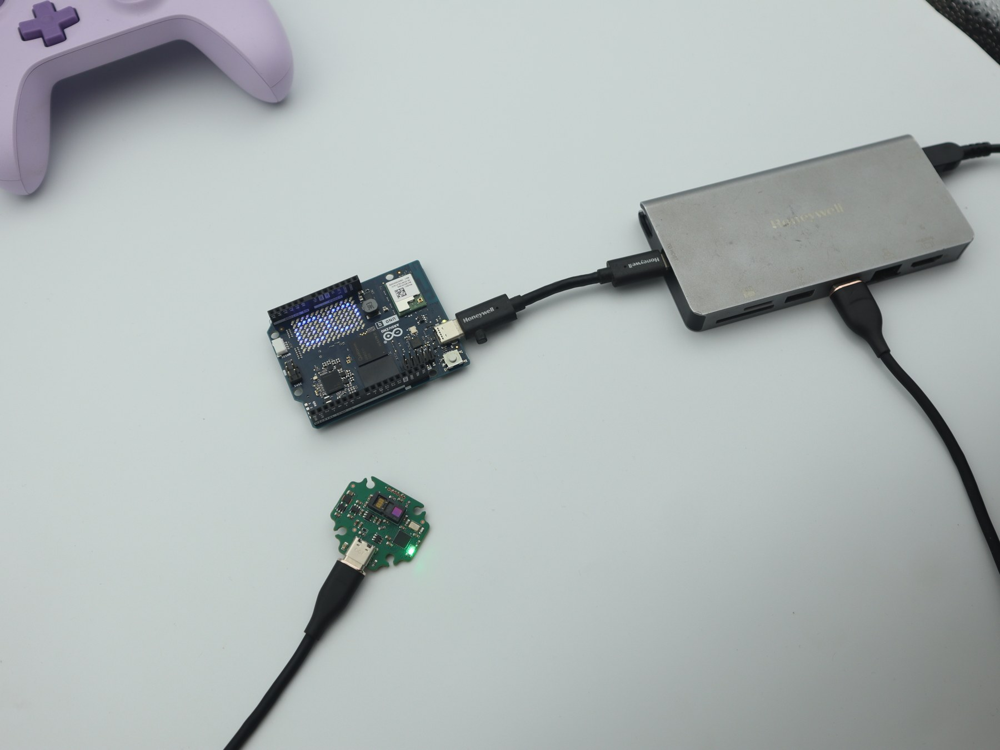
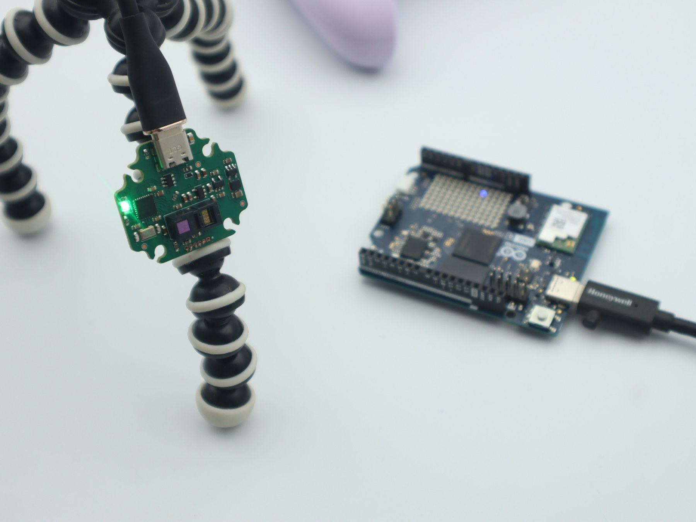
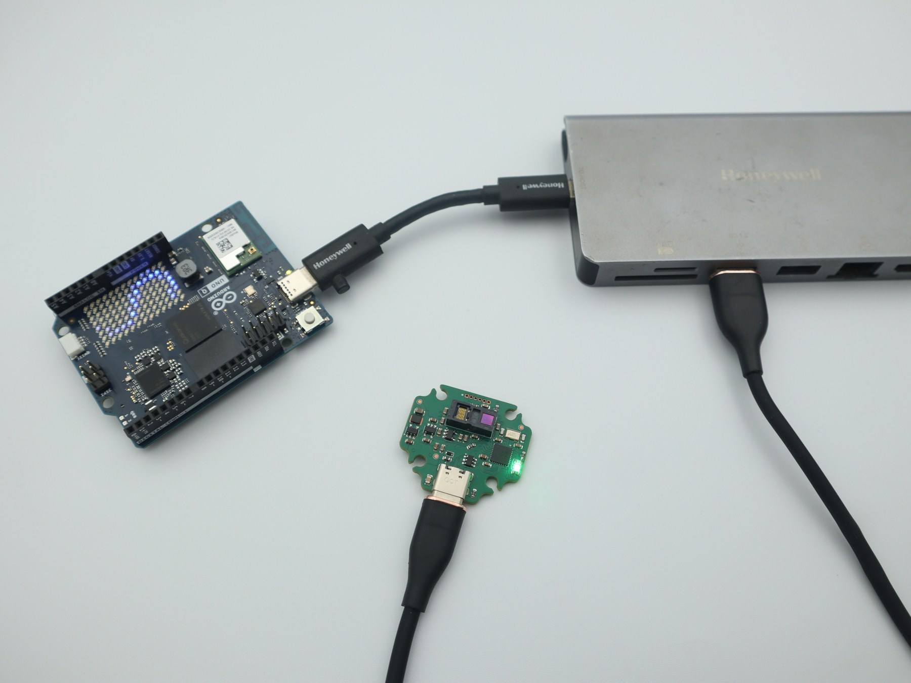
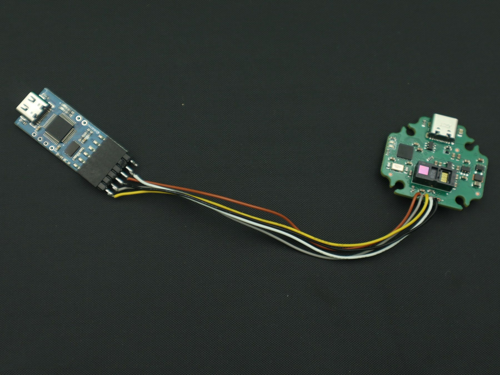
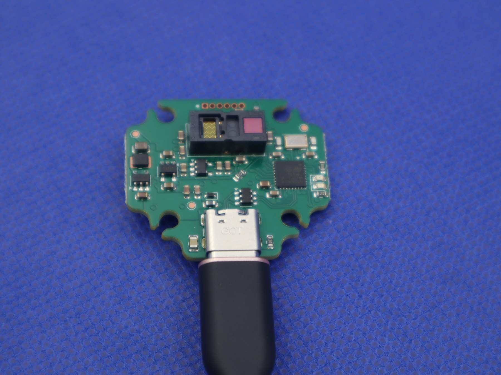

# Hardware and testing photos

Project photos supplied by DIY Projects Labs. These document the hardware setup, not an independent accuracy or throughput measurement.

## UNO Q connected to the LiDAR through a USB hub

## LiDAR mounted on a tripod beside the UNO Q

## USB connection arrangement

## ST-Link and LiDAR programming connection

## Assembled VL53L9CX LiDAR board

